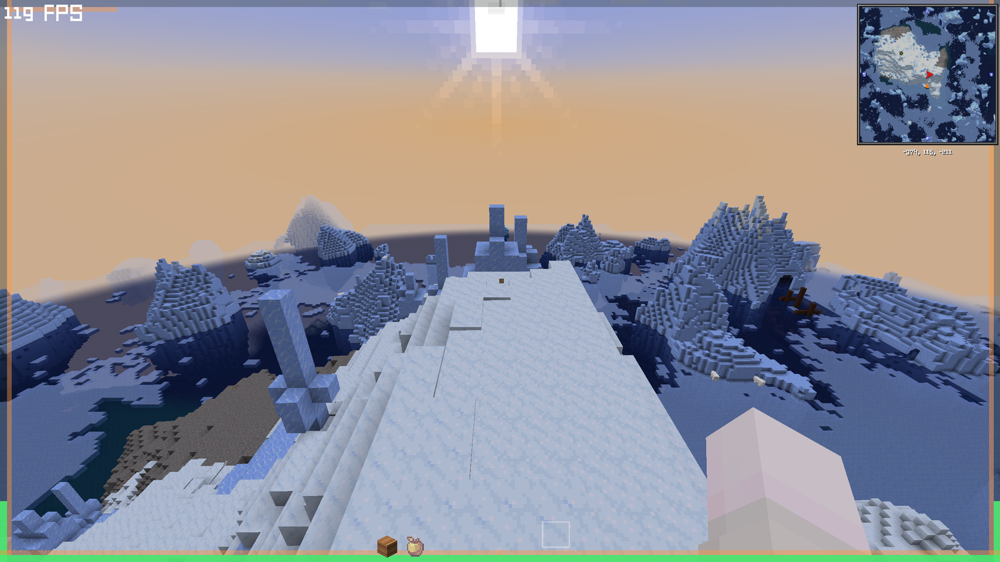

# Immersive HUD

**English** | [简体中文](README.zh-CN.md)

> **A cleaner HUD** — hides the vanilla bars and keeps only the essentials.

Hides the vanilla health, hunger, armour and experience bars and keeps the essentials at the edge of the screen, for a cleaner, less cluttered view. Everything is configurable in game.



## Features

- **One metre, two shapes.** A ring that fills from the middle of the bottom edge, runs out to both corners, climbs both sides and closes in the middle of the top edge — or a straight bar on any of the four edges.
- **Health and absorption share it.** Split by ratio, absorption on top, and health keeps at least half the ring while you are at full health.
- **Hunger sits flush inside it**, with saturation laid over the hunger band.
- **Air takes the hunger band over** while you are underwater.
- **Experience takes it over** for a couple of seconds after you pick any up, then fades back. The level number lives in a corner and stays faint.
- **Vanilla layers are cancelled**: health, hunger, armour, experience bar, experience level, air — and AppleSkin's overlays with them.
- **The hotbar is redrawn** without its background texture, faded, with the selected slot scaled up.
- **Creative mode hides the metre** by default; spectators get nothing at all.
- **No config library needed**: a five-page config screen is built in.

## Requirements

| | |
|---|---|
| Minecraft | 1.21.1 |
| Loader | NeoForge 21.1.x |
| Side | Client only |
| Dependencies | None |

## Installation

Drop the jar into your `mods` folder. It is client side only, so a server does not need it and will not complain about it.

## Configuration

Three equivalent ways in:

1. `Options → Mods → Immersive HUD → Config` (five tabs: Display / Colors / Hide / Hotbar / Misc)
2. A keybind, **unbound by default** — set it under `Options → Controls → Immersive HUD`
3. The file `config/immersivehud-client.toml`

Changes take effect immediately; the file is written when you close the screen.

## Compatibility notes

- **AppleSkin** — its drumsticks and saturation overlay sit on the vanilla hunger position, so its HUD layers are cancelled by default. Saturation is drawn by this mod instead (it is plain vanilla data). Its inventory tooltips are untouched. Set `hideAppleSkin = false` to keep AppleSkin's own overlay.
- **Mods that draw around the hotbar** — the replacement hotbar is scaled and lifted, so anything positioned against the vanilla hotbar coordinates may look misaligned. Set `hotbarScale = 1.0` and `hotbarYOffset = 0`, or `hideHotbar = false` to keep the vanilla one.
- **Other HUD replacement mods** — cancelling is done by vanilla layer id, so two mods replacing the same bar will both take effect.
- **Iris / shaders** — the HUD is drawn with plain fills only, no offscreen targets, so shader packs do not affect it.

## Building

This project is built with plain `javac` against the same jar list a running NeoForge client uses — no Gradle, no network. See `build.ps1`:

```powershell
# classpath.txt = the semicolon separated jar list your launcher uses
.\build.ps1 -ClasspathFile C:\path\to\classpath.txt

# optional: copy the finished jar into a mods folder
.\build.ps1 -ClasspathFile C:\path\to\classpath.txt -DeployTo C:\path\to\mods
```

The usual ForgeGradle / NeoGradle setup works too, if you would rather use an IDE.

## License

MIT — see [LICENSE](LICENSE).
