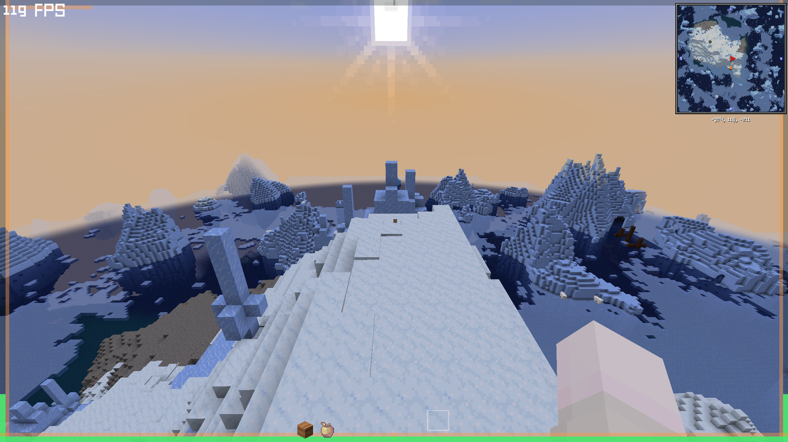

# Immersive HUD

[English](README.md) | **简体中文**

> **更干净的 HUD** —— 隐藏原版条，只保留必要信息。

把平时常驻的生命、饥饿、护甲和经验条尽量隐藏，只把还需要的信息推到屏幕边缘，让画面保持通透。全部可在游戏内调整。



## 特性

- **一条仪表，两种形态**：环绕整屏的环——从底边中点向两侧铺开、沿两侧向上、在顶边中央合拢；或者放在屏幕任意一边的直线条。
- **生命与吸收共用**：按比例分割，吸收在上；满血时生命至少占一半。
- **饥饿紧贴内圈**，饱和度叠在饥饿段上。
- **潜水时氧气顶替**饥饿段。
- **拾取经验时经验顶替**饥饿段两三秒后淡出；等级数字放在角落，平时很淡。
- **取消原版图层**：生命、饥饿、护甲、经验条、经验等级、氧气，AppleSkin 的覆盖层一并取消。
- **快捷栏重绘**：去掉底图、整体淡化、选中物品放大上浮。
- **创造模式默认隐藏仪表**，旁观模式什么都不显示。
- **不需要配置库**：自带五页设置界面。

## 环境要求

| | |
|---|---|
| Minecraft | 1.21.1 |
| 加载器 | NeoForge 21.1.x |
| 侧 | 仅客户端 |
| 依赖 | 无 |

## 安装

把 jar 放进 `mods` 目录即可。仅客户端生效，服务端不需要安装，也不会因为缺失而被踢。

## 配置

三种等价入口：

1. `选项 → 模组 → Immersive HUD → 配置`（五个标签页：显示 / 颜色 / 隐藏 / 物品栏 / 其它）
2. 快捷键，**默认未绑定** —— 在 `选项 → 控制 → Immersive HUD` 里自己设
3. 配置文件 `config/immersivehud-client.toml`

改完立即生效，关闭界面时写入文件。

## 兼容性说明

- **AppleSkin**：它的鸡腿和饱和度覆盖画在原版饥饿条位置，所以默认把它的 HUD 图层一并取消；饱和度由本模组自己画（是原版数据）。背包内的食物 tooltip 不受影响。想保留它自己的覆盖层，设 `hideAppleSkin = false`。
- **在快捷栏附近画东西的模组**：替换后的快捷栏做了缩放和上移，按原版坐标定位的装饰可能错位。可以把 `hotbarScale` 设成 `1.0`、`hotbarYOffset` 设成 `0`，或者 `hideHotbar = false` 用回原版快捷栏。
- **其它 HUD 替换模组**：取消是按原版图层 ID 做的，两个模组替换同一条时都会生效。
- **Iris / 光影**：HUD 只用平涂矩形绘制，没有离屏缓冲，光影包不影响它。

## 构建

本项目用纯 `javac` 对着运行中 NeoForge 客户端的依赖列表编译——不走 Gradle、不需要联网。见 `build.ps1`：

```powershell
# classpath.txt 是启动器使用的那份分号分隔的 jar 列表
.\build.ps1 -ClasspathFile C:\path\to\classpath.txt

# 可选：把成品 jar 直接复制进 mods
.\build.ps1 -ClasspathFile C:\path\to\classpath.txt -DeployTo C:\path\to\mods
```

想用 IDE 的话，标准的 ForgeGradle / NeoGradle 工程也可以直接编译这份源码。

## 许可证

MIT —— 见 [LICENSE](LICENSE)。
